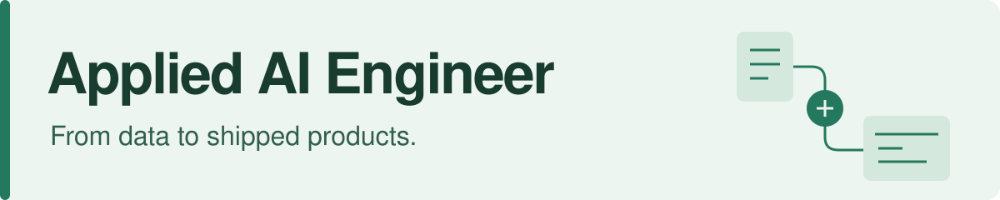
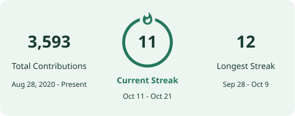
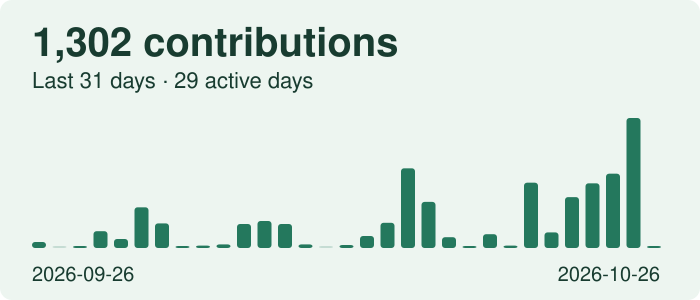

<picture>
  <source media="(max-width: 600px) and (prefers-color-scheme: dark)" srcset="./assets/header-mobile-dark.svg">
  <source media="(max-width: 600px)" srcset="./assets/header-mobile-light.svg">
  <source media="(prefers-color-scheme: dark)" srcset="./assets/header-dark.svg">
  
</picture>

I build retrieval systems, voice agents, and document workflows, including the data pipelines, backend services, and interfaces people use.

Currently **AI Engineer at Boa Safra Ag**. Previously **NCompas Technology Solutions**. Based in Cleveland, Ohio.

**[LinkedIn](https://www.linkedin.com/in/princeu/)** · **[StyleOS](https://styleos.dev)** · **[Public repositories](https://github.com/Princeu3?tab=repositories)** · **[Email](mailto:princeupadhyay1401@gmail.com)**

  <picture>
    <source media="(prefers-color-scheme: dark)" srcset="./assets/streak-dark.svg">
    
  </picture>

## From problem to product

I work through requirements, data, model behavior, APIs, and UI, then test and deploy the result. I care about what happens after the first convincing demo: answer quality, permissions, failure handling, and whether the product is useful.

| Where I've worked | What I've built |
| :--- | :--- |
| **Agriculture & business operations** · Boa Safra Ag | Document processing, a hiring platform, spoken-answer training tools, and a company knowledge assistant with retrieval and citation tests. |
| **Healthcare** · NCompas | Voice agents that collect patient intake details and notify the on-call specialist. |
| **Business networks** · NCompas | An AI referral platform delivered for **16 partner companies**, with customer profiles and suggested introductions. |
| **Energy & geospatial data** · NCompas | A pipeline covering **2.7 million utility circuit segments across eight utilities**, plus a map-based demo for EV charging site selection. |

## Selected work

### [StyleOS](https://styleos.dev) · Consumer AI

An AI wardrobe app I help build and run, now on **[the App Store](https://apps.apple.com/us/app/styleos/id6811260917)** and the web. Add clothes from photos or shop links, ask Foldy for outfit ideas, and explore virtual try-on. Started at NexHacks at Carnegie Mellon; we kept building after the weekend.

### [TextDM](https://github.com/Princeu3/textdm) · Agent integrations

A Python connector that gives AI agents an iMessage, Telegram, or WhatsApp interface. Normalizes messages, attachments, voice notes, and reactions across providers, with scheduled check-ins and FastAPI webhooks.

### [The company brain playbook](https://github.com/Princeu3/company-brain-playbook) · Systems design

Public research, design decisions, and reusable templates from building a company knowledge assistant. Covers retrieval, changing documents, access control, evaluation, and the choice to build or buy.

### [NLP for Digital Humanities](https://github.com/Princeu3/NLP4DH) · Research

OCR and writing-style analysis for historical documents, using spaCy and NLTK. Work presented at the **NLP4DH workshop at EMNLP 2024**. [Proceedings](https://zenodo.org/records/14029382).

<strong>More engineering: agent tooling and multimodal AI</strong>

- [ReAct agent loop](https://github.com/Princeu3/react-agent-loop) — a small TypeScript loop with pluggable tools and guardrail hooks.
- [Agent policy engine](https://github.com/Princeu3/agent-policy-engine) — tool-call policies, spend limits, allowlists, and path protection.
- [Agent budget guard](https://github.com/Princeu3/agent-budget-guard) — inference budgets and model downgrades when funds run low.
- [Agent loop detector](https://github.com/Princeu3/agent-loop-detector) — repeated calls, cyclic patterns, and idle polling loops.
- [The Unreliable Narrator](https://github.com/Princeu3/unreliable-narrator) — a hackathon prototype that separates what's said, shown, and written in video, then queries it with Neo4j.

## Tools I reach for

| Area | Tools & methods |
| :--- | :--- |
| **AI & evaluation** | RAG, LLM APIs, LangGraph, DSPy, PyTorch, Langfuse |
| **Backend & data** | Python, TypeScript, SQL, FastAPI, PostgreSQL / pgvector, Neo4j, Redis, MCP |
| **Product interfaces** | React, Next.js |
| **Voice** | LiveKit, Deepgram, Twilio |
| **Deployment** | Docker, AWS, Azure, Railway, GitHub Actions |

## Beyond the build

B.A. in Data Science from **Beloit College**, summa cum laude. NCAA track, tournament chess, and four years of hackathons shaped how I learn and work with a team. After **12+ hackathons as a participant**, I've also judged **HopHacks** and **MHacks**.

I share projects, engineering decisions, and lessons from shipping on **[LinkedIn](https://www.linkedin.com/in/princeu/)**. If you're building useful AI products, I'd be glad to compare notes.

## GitHub activity

<picture>
  <source media="(prefers-color-scheme: dark)" srcset="./assets/activity-dark.svg">
  
</picture>

<picture>
  <source media="(prefers-color-scheme: dark)" srcset="./assets/snake-dark.svg">
  
</picture>

Stats refresh daily. [Contribution history](https://github.com/Princeu3?tab=overview) · [Streak Stats](https://github.com/DenverCoder1/github-readme-streak-stats) · [Snake](https://github.com/Platane/snk)
